# Mister Download Manager

  

  
  
  

  Windows 10 and 11 (x64, ARM64, 32-bit) · Linux (Ubuntu, Debian, Mint, Fedora, openSUSE, Arch and more; x86-64 and ARM64) · macOS (Apple Silicon and Intel, experimental) 
  87 languages · no ads, no trial, no sign-up

<table align="center">
  <tr>
    <td align="center" width="210"><h1>5×</h1><b>Faster</b> a 1 GB file: 1 s instead of 5.5 s, on a local test server</td>
    <td align="center" width="210"><h1>+47</h1><b>More languages</b> 87 instead of IDM's 40</td>
    <td align="center" width="210"><h1>100%</h1><b>Cheaper (free!)</b> no licence, no trial, ever</td>
    <td align="center" width="210"><h1>Torrent</h1><b>Supported fully</b> magnet links, .torrent files, seeding</td>
  </tr>
</table>

  <picture>
    <source media="(prefers-color-scheme: dark)" srcset="docs/images/main-dark.webp">
    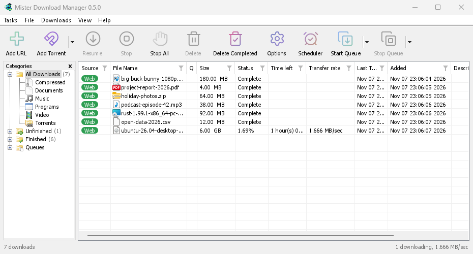
  </picture>

  
  
  
  
  
  
  

| 🚀 [Download](#download) | ⚡ [Why switch](#why-switch-from-idm) | 🖼️ [Screenshots](#screenshots) | ✨ [Getting started](docs/getting-started.md) | 📜 [Help and tutorials](docs/README.md) |
| --- | --- | --- | --- | --- |

## Why switch from IDM?

**Same window you know. Your downloads finish sooner. And it costs nothing.**

  <picture>
    <source media="(prefers-color-scheme: dark)" srcset="docs/images/races-dark.svg">
    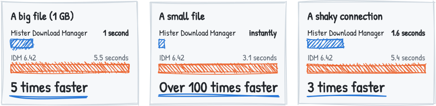
  </picture>

<!-- compare:start -->
| | Mister Download Manager | IDM 6.42 |
| --- | --- | --- |
| Download a big file (1 GB) | **1 second** | 5.5 seconds |
| Download a small file | **instantly** | 3.1 seconds |
| Download over a shaky connection | **1.6 seconds** | 5.4 seconds |
| Wait before a download starts | **instantly** | 3.1 seconds |
| Price | **Free, forever** | Paid, after a 30-day trial |
| Ads, nag screens, sign-up | **None** | Registration needed |
| Open source | **Yes** (GPL) | No |
<!-- compare:end -->

Nothing new to learn: the toolbar, the categories, the list of downloads, the progress window and
the browser button are where you expect them. Measured on the same computer, downloading from a
test server on that computer (a loopback test: it times the programs, not an internet connection),
same files, both programs at their default settings).

## Download

[View all releases](../../releases)

| Platform | Download | Run |
|----------|----------|-----|
| **Windows x64** | [misterdownloadmanager-x64.7z](../../releases) | Run installer → launch `misterdownloadmanager-x64.7z` |
| **Linux x64** | [misterdownloadmanager-Linux-x64.run](../../releases) | `chmod +x` → run installer |
| **macOS Apple Silicon** | [misterdownloadmanager-macOS-arm64.dmg](../../releases) | Open DMG → drag to Applications |

## Screenshots

<table>
  <tr>
    <td width="50%"> <b>One click on YouTube</b>: the Download video button appears over the video.</td>
    <td width="50%">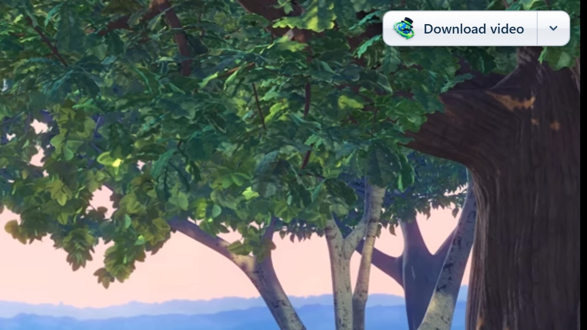 <b>Any video on any page</b>: drag the button where you like, it stays there.</td>
  </tr>
  <tr>
    <td width="50%">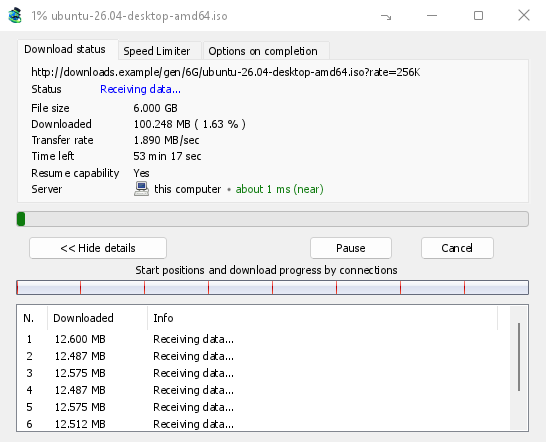 <b>Watch it fly</b>: every connection's share of the file, live speed and time left.</td>
    <td width="50%">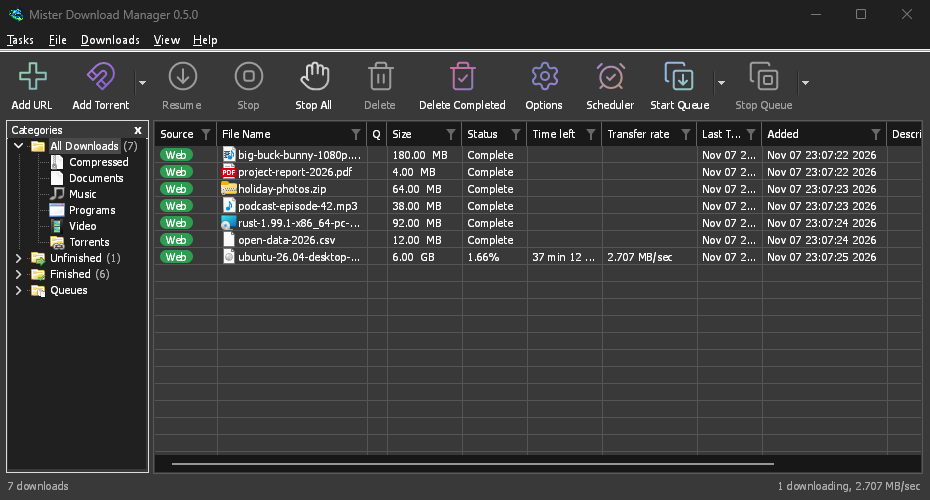 <b>Dark mode</b> that follows Windows.</td>
  </tr>
  <tr>
    <td>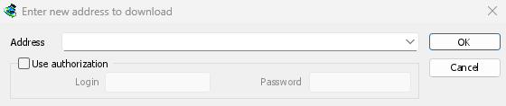 <b>Add a download</b>: paste a link, or let MDM catch it from your browser.</td>
    <td>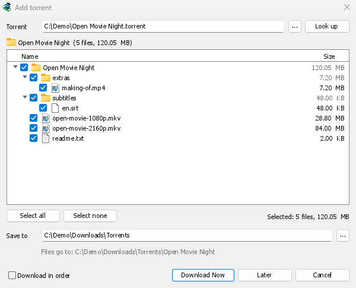 <b>Torrents and magnet links</b>: pick the files you want, skip the rest.</td>
  </tr>
  <tr>
    <td>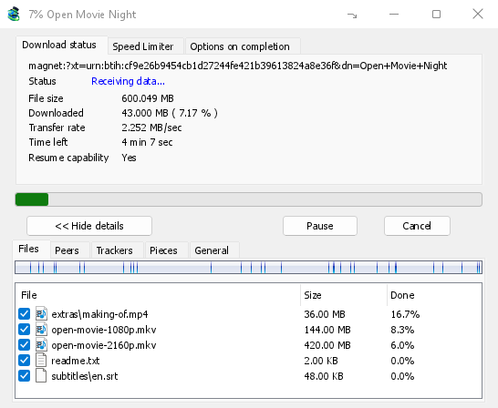 <b>A torrent's progress</b>: its files, peers, trackers and pieces, in tabs.</td>
    <td>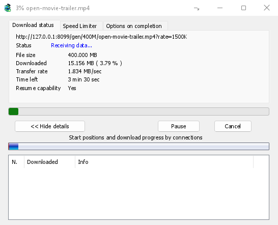 <b>A video's progress</b>: speed and time left while yt-dlp brings it in.</td>
  </tr>
  <tr>
    <td>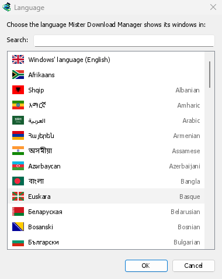 <b>87 languages</b>, chosen by flag on the first start.</td>
    <td>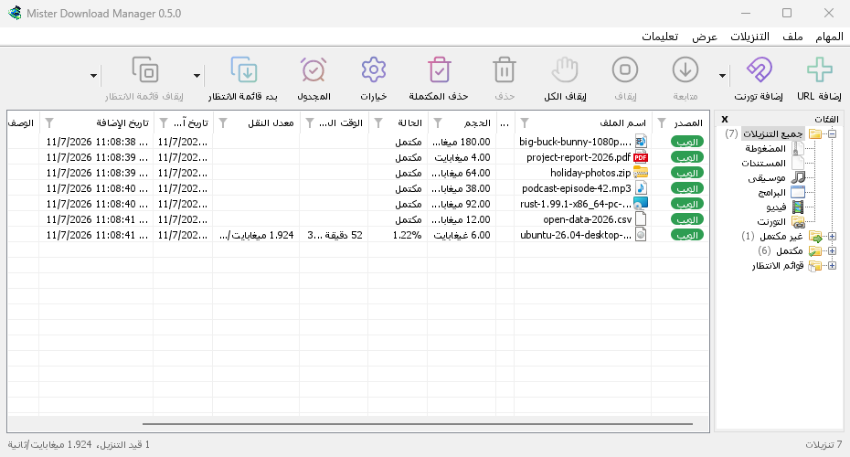 <b>Right to left</b> for Arabic, Hebrew, Persian, Urdu and Uyghur.</td>
  </tr>
  <tr>
    <td>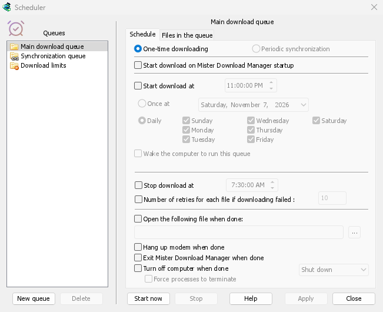 <b>Download overnight</b>: queues that start and stop on their own.</td>
    <td>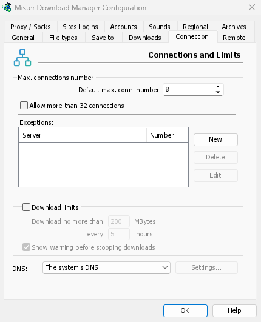 <b>Options</b> where you expect them, every control working.</td>
  </tr>
</table>

## What it does

- **Speeds up every download** by fetching parts of the file at the same time, and keeps
  re-balancing until the last byte.
- **Resumes** after a crash, a restart or a dropped connection, without starting over.
- **Site rules**: a User-Agent, extra request headers, a number of connections and "connect the
  way a browser does" for every download from a site (`*.example.com`). A stopped download's
  Properties change its own headers, proxy and connections, and MDM checks it is still the same
  file before it goes on ([how](docs/connections-and-speed.md#site-rules)).
- **Catches downloads from Firefox, Chrome, Edge, Brave, Opera, Vivaldi and Helium** (the
  extension is on Firefox Add-ons and the Chrome Web Store), and gives them back to the browser
  when MDM isn't running. Its toolbar button finds **all the images on a page**, at the largest
  size the page lists, filtered by size and type, and sends them to the Link grabber; the
  right-click menu's **Download all links** brings the page's pictures too, hidden until you ask.
- **Downloads videos** from web pages (a button appears over the video, on many pages before it plays; playlists,
  subtitles, the sound alone), **image galleries** with gallery-dl, and **torrents and magnet links**
  (sequential order, RSS feeds, sharing limits, an optional public tracker list for more peers).
- **Many links at once**: the Link grabber sorts them into packages and extracts the archives
  (zip, 7z, rar) when they're in. Give it an **FTP folder or a web server's "Index of" page** and it
  lists every file in it and its subfolders, keeping the folder tree when they download; paste a
  **Hugging Face model or dataset** or a **GitHub release** and it lists their files, each checked
  against the digest the site publishes. For a big
  `.zip` on a server, **Preview** lists the files inside and downloads only the ones you tick. It takes
  Click'n'Load from link sites, asking once per site, and
  unwraps `thunder://`, `flashget://` and `qqdl://` links to the address inside them. Debrid accounts (Real-Debrid, AllDebrid, Premiumize, TorBox, Mega-Debrid; experimental) download
  file-host links through your own account.
- **Sorts downloads into categories** by file type, each with a folder of its own, or **every
  download in one folder** if you prefer, the categories still sorting the list
  ([how](docs/options.md#save-to)).
- **A list laid out your way**: show, move, resize and sort its columns, **Save To** (the folder
  each download is in) among them, choose them and their order in the **Columns** window (from
  the keyboard too), and filter any column ([how](docs/download-list.md)).
- **Downloads overnight** with queues and a scheduler that can wake the computer, then shuts it
  down if you like.
- **Through your VPN only**, if you want: hold every download to one network adapter, with a kill
  switch, and choose an encrypted DNS. Each download shows its server's country.
- **From your phone, or on a server**: control MDM from a phone on your home network, or run it
  without a window on a NAS (Docker, Unraid) ([how](docs/server.md)).
- **Works from scripts too**: IDM's command-line switches, a command-line tool, and a local API for other programs ([how](docs/command-line.md)).
- **Works with your AI assistant**: an MCP server lets Claude, Cursor or VS Code list, add, pause and remove your downloads ([set it up](docs/ai-assistants.md)).
- **Leaves you some speed**: limit one download or all of them, only while you're at the computer.
- **Stays out of your game**: while a full-screen game, video or presentation is on, or the screen
  is locked, **Download complete** and MDM's other pop-ups wait, and show when you're back
  ([how](docs/options.md#downloads)).
- **Day and dark mode, and themes**: Classic, Native, High contrast, Metro, Adwaita, Breeze,
  Luna, Aero and Aqua, or your own in a text file ([how](docs/themes.md)). Everything larger, up
  to 200 %, with **View → Interface size**. 87 languages, and a portable version for USB sticks.
- **Works from the keyboard and with screen readers** (Narrator, NVDA): every window, dialog and
  menu ([the keys](docs/keyboard-shortcuts.md)).
- **No ads, no trial, no account**. Free and open source.

Step by step: [your first download](docs/guide-first-download.md) ·
[catch every browser download](docs/guide-catch-browser-downloads.md) ·
[download overnight](docs/guide-download-overnight.md) ·
[download a video](docs/guide-video-from-page.md) · [all help pages](docs/README.md)

---

## The benchmark in detail

Both programs downloaded the same files from the same local test server
([labserver](crates/labserver)), with the network trouble each scenario names: seven runs each,
both at their default settings. MDM finished first in **all seven scenarios**; every difference is
statistically significant (Mann-Whitney p < 0.001), and MDM used less CPU in every one.

  <picture>
    <source media="(prefers-color-scheme: dark)" srcset="docs/images/bench-time-dark.svg">
    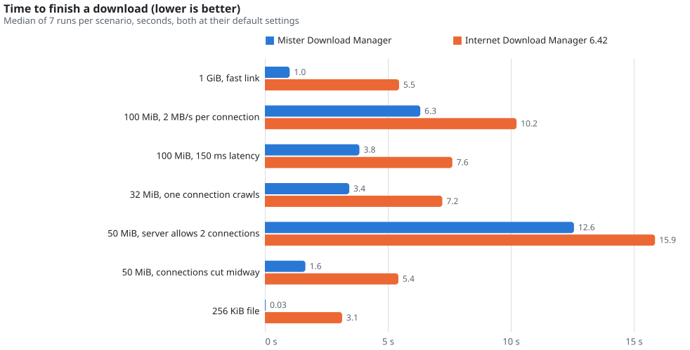
  </picture>

On a server that allows only two connections, MDM used 2 and still finished first; IDM opened 480.
The full table, the machine and the raw data: [docs/bench/run5/REPORT.md](docs/bench/run5/REPORT.md).
The harness is in [tools/bench](tools/bench), so anyone can run it again.

## Not a reverse-engineering project

MDM is an independent, clean-room program. It is a new implementation of a familiar way of
working, not a copy of anyone's software.

- **No one else's code or assets.** It contains no code, binaries, artwork, icons, sounds or
  text from Internet Download Manager, nor code from any other download manager. The app icon
  was made for MDM with ChatGPT (OpenAI's image generation);
- **Nothing taken apart.** No IDM file was ever disassembled, decompiled, debugged, patched or
  inspected below its user interface, and its licensing, trial and registration were never
  touched or bypassed.
- **Learned as a user learns.** What MDM does was learned from IDM's public documentation and
  help pages, its public screenshots, and by using a licensed copy as a black box: downloading
  test files from our own test server ([labserver](crates/labserver)) and watching what reached
  the network and the screen.
- **Built on public standards.** The download engine follows the HTTP specifications (RFC 9110,
  RFC 9112) and was designed, tested and measured independently. Its speed comes from its own
  design, which the benchmark shows.
- **Not affiliated.** MDM isn't affiliated with, endorsed by or connected to Tonec Inc.
  "Internet Download Manager" and "IDM" are trademarks of their owner, named here only to
  describe the layout people already know and to compare the two programs.

## Status and helping out

MDM is young: the engine, the main window and the browser integration are solid on Windows and
Linux, and some corners are still "good enough for now".

- **Translations are machine-made.** Rows marked `#, machine` in [`i18n/`](i18n) wait for a
  native speaker; fixing one is a one-line pull request ([how](docs/languages.md)). Malay's
  menus, toolbar and download-list columns have been reviewed by a native speaker.
- Not yet: code signing. The macOS builds are untested; on Linux, screen readers (Orca) and
  Flatpak browsers aren't supported yet.

## ⭐ Star history

If MDM saves you time, a star is the quickest way to say so, and it helps the next person find
a free download manager. [Star it on GitHub](https://github.com/anefzaoui/misterdownloadmanager/stargazers).

<a href="https://star-history.com/#anefzaoui/misterdownloadmanager&Date">
  <picture>
    <source media="(prefers-color-scheme: dark)" srcset="https://api.star-history.com/svg?repos=anefzaoui/misterdownloadmanager&type=Date&theme=dark">
    
  </picture>
</a>

## Licence and credits

Copyright (c) 2026 Ahmed Nefzaoui. Mister Download Manager is free software under the
[GNU General Public License, version 3](LICENSE) or (at your option) any later version.
